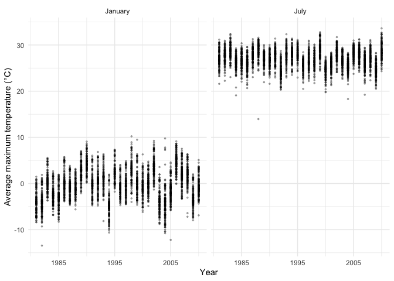
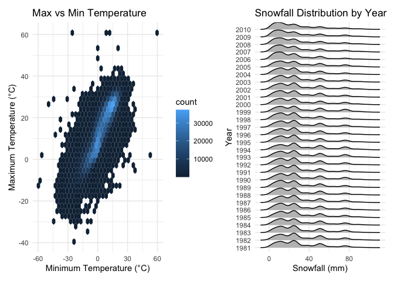

Homework 3
================

# Problem 1

``` r
library(p8105.datasets)
data("ny_noaa")

dim(ny_noaa)
```

    ## [1] 2595176       7

``` r
str(ny_noaa)
```

    ## Classes 'tbl_df', 'tbl' and 'data.frame':    2595176 obs. of  7 variables:
    ##  $ id  : chr  "US1NYAB0001" "US1NYAB0001" "US1NYAB0001" "US1NYAB0001" ...
    ##  $ date: Date, format: "2007-11-01" "2007-11-02" ...
    ##  $ prcp: int  NA NA NA NA NA NA NA NA NA NA ...
    ##  $ snow: int  NA NA NA NA NA NA NA NA NA NA ...
    ##  $ snwd: int  NA NA NA NA NA NA NA NA NA NA ...
    ##  $ tmax: chr  NA NA NA NA ...
    ##  $ tmin: chr  NA NA NA NA ...
    ##  - attr(*, "spec")=List of 2
    ##   ..$ cols   :List of 7
    ##   .. ..$ id  : list()
    ##   .. .. ..- attr(*, "class")= chr [1:2] "collector_character" "collector"
    ##   .. ..$ date:List of 1
    ##   .. .. ..$ format: chr ""
    ##   .. .. ..- attr(*, "class")= chr [1:2] "collector_date" "collector"
    ##   .. ..$ prcp: list()
    ##   .. .. ..- attr(*, "class")= chr [1:2] "collector_integer" "collector"
    ##   .. ..$ snow: list()
    ##   .. .. ..- attr(*, "class")= chr [1:2] "collector_integer" "collector"
    ##   .. ..$ snwd: list()
    ##   .. .. ..- attr(*, "class")= chr [1:2] "collector_integer" "collector"
    ##   .. ..$ tmax: list()
    ##   .. .. ..- attr(*, "class")= chr [1:2] "collector_character" "collector"
    ##   .. ..$ tmin: list()
    ##   .. .. ..- attr(*, "class")= chr [1:2] "collector_character" "collector"
    ##   ..$ default: list()
    ##   .. ..- attr(*, "class")= chr [1:2] "collector_guess" "collector"
    ##   ..- attr(*, "class")= chr "col_spec"

``` r
colSums(is.na(ny_noaa))
```

    ##      id    date    prcp    snow    snwd    tmax    tmin 
    ##       0       0  145838  381221  591786 1134358 1134420

The NY NOAA dataset has 2,595,176 rows and 7 columns. It is a tibble
containing daily weather records from different stations. The main
variables include station ID, date, precipitation, snowfall, snow depth,
and maximum and minimum temperatures. There are many missing values,
especially for tmax and tmin, which each have over 1.1 million missing
values. Other weather variables also have missing values, but ID and
date do not.

``` r
library(dplyr)
```

    ## 
    ## Attaching package: 'dplyr'

    ## The following objects are masked from 'package:stats':
    ## 
    ##     filter, lag

    ## The following objects are masked from 'package:base':
    ## 
    ##     intersect, setdiff, setequal, union

``` r
library(lubridate)
```

    ## 
    ## Attaching package: 'lubridate'

    ## The following objects are masked from 'package:base':
    ## 
    ##     date, intersect, setdiff, union

``` r
noaa_clean <- ny_noaa |>
  mutate(
    year = year(date),
    month = month(date),
    day = day(date),
    prcp = prcp / 10,
    tmax = as.numeric(tmax) / 10,
    tmin = as.numeric(tmin) / 10
  )

sort(table(noaa_clean$snow), decreasing = TRUE)[1:10]
```

    ## 
    ##       0      25      13      51      76       8       5      38       3     102 
    ## 2008508   31022   23095   18274   10173    9962    9748    9197    8790    6552

The most common snowfall value is 0 mm, with 2,008,508 observations,
because most days have no snow. The next most common values are 25 mm
and 13 mm, likely because snowfall measurements were converted from
inches to metric units.

``` r
library(ggplot2)

jan_jul <- noaa_clean |>
  filter(month == 1 | month == 7, !is.na(tmax)) |>
  group_by(id, year, month) |>
  summarize(mean_tmax = mean(tmax), .groups = "drop") |>
  mutate(
    month = factor(month, levels = c(1, 7),
                   labels = c("January", "July"))
  )

ggplot(jan_jul, aes(x = year, y = mean_tmax)) +
  geom_point(alpha = 0.3, size = 0.6) +
  facet_wrap(~month) +
  scale_x_continuous(breaks = c(1985, 1995, 2005)) +
  labs(
    x = "Year",
    y = "Average maximum temperature (°C)"
  ) +
  theme_minimal()
```

<!-- -->

January temperatures are much lower and vary more across years, while
July temperatures are more consistent, mostly around 25–30°C. There is
no clear overall trend over time. There are a few outliers, especially
some unusually low temperatures in July.

``` r
library(ggridges)
library(patchwork)

snow_data <- noaa_clean |>
  filter(snow > 0, snow < 100)

snow_plot <- ggplot(snow_data, aes(x = snow, y = factor(year))) +
  geom_density_ridges(fill = "grey75", scale = 1) +
  labs(
    title = "Snowfall Distribution by Year",
    x = "Snowfall (mm)",
    y = "Year"
  ) +
  theme_minimal()

temp_data <- noaa_clean |>
  filter(!is.na(tmax), !is.na(tmin))

temp_plot <- ggplot(temp_data, aes(x = tmin, y = tmax)) +
  geom_hex(bins = 35) +
  labs(
    title = "Max vs Min Temperature",
    x = "Minimum Temperature (°C)",
    y = "Maximum Temperature (°C)"
  ) +
  theme_minimal()

temp_plot + snow_plot
```

    ## Picking joint bandwidth of 3.76

<!-- -->

Snowfall amounts are mostly low, and the distributions look similar
across years with no clear trend. There is a clear positive relationship
between tmin and tmax, with a few unusual values outside the main
pattern.

# Problem 2

# Problem 3
